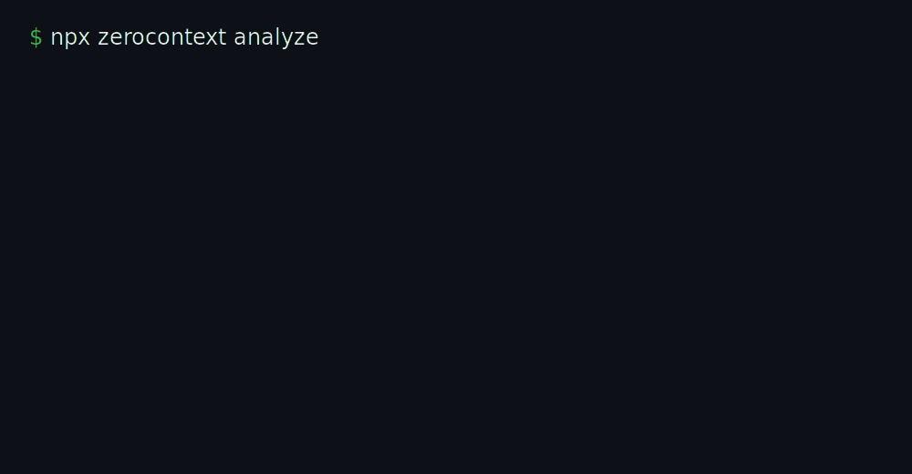

# ZeroContext

> **Your AI tools waste tokens on rules you don't need right now. ZeroContext serves only the rules that match the code you're working on.**

<p align="center">
  
</p>

<p align="center"><sub><i>A real run on the bundled <a href="demo/fixture"><code>demo/fixture</code></a> project — your numbers will differ. Regenerate the GIF with <code>node demo/render.mjs</code>.</i></sub></p>

`CLAUDE.md` and `.cursorrules` load *everything you've ever written* into every message —
keeping rules in the window that have nothing to do with the code in front of you.
ZeroContext is a local MCP server that inspects your project and hands the agent **only
the rules it asks for, when it asks** — just-in-time, per file and stack. A smaller,
sharper window, better-targeted answers, and zero config files cluttering your repo.

```bash
npx zerocontext init      # writes MCP config pointing at the local server
npx zerocontext serve     # stdio MCP server: serves matching rules on request
npx zerocontext analyze   # see how many rule tokens your CLAUDE.md / .cursorrules costs per message
```

> 📊 **This repo's own `CLAUDE.md` keeps 1,913 rule tokens in every message's window — ZeroContext keeps ~80% of them out, serving only the slice the task needs.**

**One honesty note, up front:** this is a **window-scoping** number, not a cheaper bill. A
preloaded `CLAUDE.md` is prompt-cached, and our Phase 0 A/B found just-in-time ran
cost-neutral-to-higher end to end. So the win is **relevance and a leaner window** — never
dollar savings.

## See your own footprint in 5 seconds

Run `analyze` on any repo with a `CLAUDE.md` or `.cursorrules` — no install required:

```text
$ npx zerocontext analyze
ZeroContext analyze — rule tokens resident in every message
Tokenizer: o200k_base (gpt-tokenizer) — proxy for Claude, ~±10–15% vs. Claude's exact count

CLAUDE.md
  1,913 tokens  ·  7,533 chars  ·  9 sections (avg 213 tok/section)
  → resident in your context window on every message, relevant or not.

  With ZeroContext (just-in-time, 1 slice/task) — rule tokens resident in the window:
    fixed overhead     135 tok   (MCP instructions + get_rules schema, measured)
    + tool call(s)      40 tok   (assumption: agent writes 1 call)
    + rule slice(s)    213 tok   (your avg section size)
    = 388 tok resident   vs   1,913 tok preloaded (every message)

  → 80% fewer rule tokens in the window  (1,525 tok)
  Break-even: ZeroContext keeps fewer resident once rules exceed ~388 tok. Yours: 1,913 ✓
```

Your numbers will differ — bigger or polyglot rule files keep more out of the window. The
percentage is the headline (tokenizer-robust); the absolute count is a labeled o200k
estimate. If your rules fall below break-even, `analyze` says so instead of inflating the
number.

## `CLAUDE.md` vs. ZeroContext

| | `CLAUDE.md` / `.cursorrules` | ZeroContext |
|---|---|---|
| When rules load | Front-loaded into every message | Pulled by the agent, only when it needs them |
| What loads | Everything you've ever written | Only the slice matching the active file / stack |
| Irrelevant rule tokens in the window | ~2–8k per message | ~0 |
| Rule files in your repo | One per AI tool | Zero (rules live in the server, served on demand) |
| Config footprint | The rule file itself | One gitignored `.mcp.json` pointer — no rules |

## How it works

ZeroContext runs as a local MCP server that your AI tool spawns per session. It inspects
the working directory, detects the stack from project signals, and exposes a `get_rules`
tool. When the agent starts working on a file or task it calls that tool and gets back
only the matching rule slice — nothing else lands in the window.

It's **agent-pulled, not a reactive editor hook.** Claude Code is a terminal agent with no
"current file" event for a server to chase, so ZeroContext serves rules just-in-time when
the agent asks — the honest mechanism that works today, no IDE extension required.

## Supported stacks

Detection is by project signal, and additive: a Next.js app is also React + TypeScript, so
both sets activate and each file gets only the slices whose globs match it.

| Signal | Rule set served |
|---|---|
| `next.config.*` or a `next` dependency | Next.js (also activates React + TypeScript) |
| `tsconfig.json` + a `react`/`react-dom` dependency | React + TypeScript |
| `drizzle.config.*` or `drizzle-orm` + `pg`/`postgres` | Node + Postgres + Drizzle |
| `pyproject.toml` with a `fastapi` dependency | FastAPI |
| `Cargo.toml` | Rust |

More stacks land as PRs come in — they aren't curated up front.

## Monorepo routing (planned)

Not wired yet. The intended shape: a single repo-root `.zerocontext.yaml` maps a path
prefix to a bundled rule-set name, so each workspace gets the right slice. Pointers only,
never inline rules — the one allowed footprint in your repo.

```yaml
# .zerocontext.yaml — planned, not yet read by the server
version: 1
routes:
  apps/web: nextjs
  services/api: fastapi
```

## How is this different?

- **vs. `awesome-cursorrules`** — that's a rules *library*; this is a *runtime* that picks
  the right slice and serves it to the agent on demand.
- **vs. native Cursor / Claude rules** — those are static and front-loaded; ZeroContext is
  just-in-time, so the tokens only land when a rule is actually relevant.

## Status

Pre-launch, solo OSS. **Phase 0 is resolved:** in a live headless session the agent called
`get_rules` on its own and got back the correct stack-matching slice, so agent-pulled
just-in-time injection works end to end. Reactive file-switch is *not* promised — it isn't
available to a terminal agent without an IDE extension. Nothing in this README claims
behavior that isn't built.

## License

MIT — see [LICENSE](LICENSE). An open-source tool that scratches a real itch.
